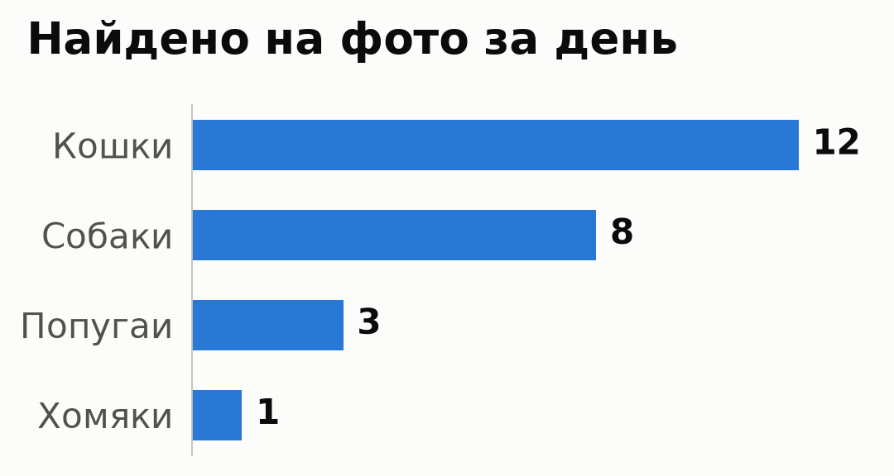
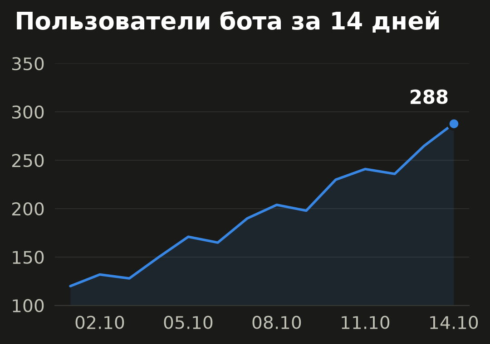
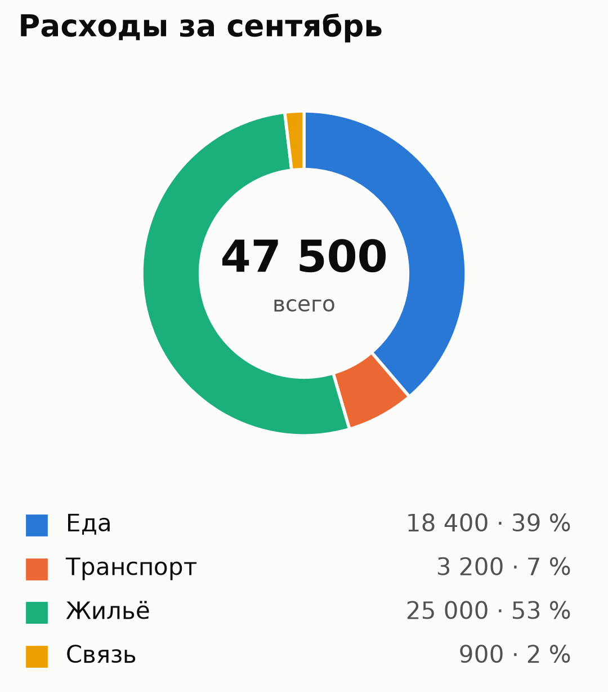
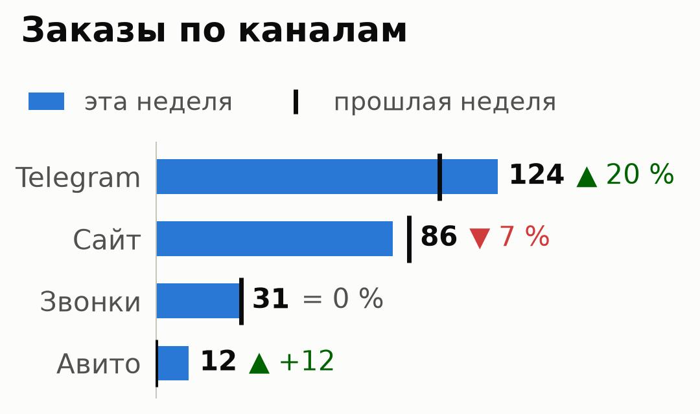
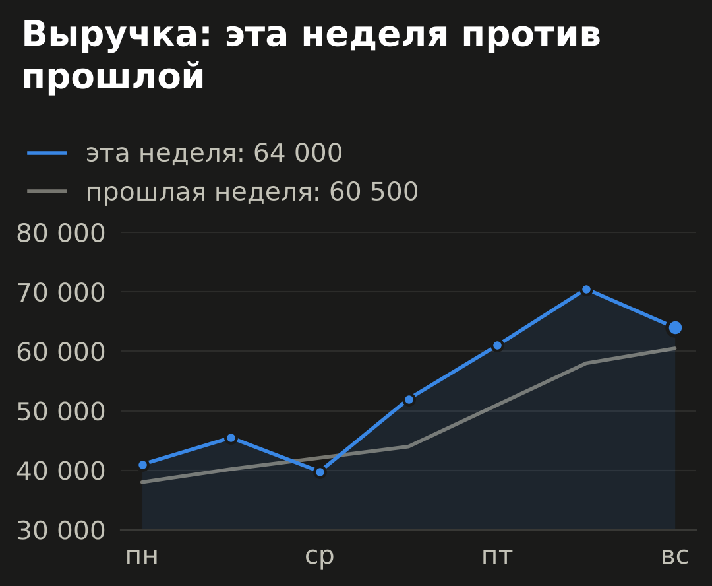
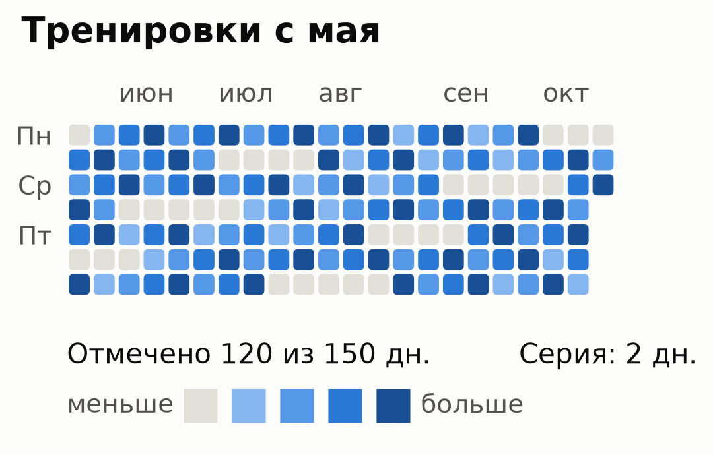
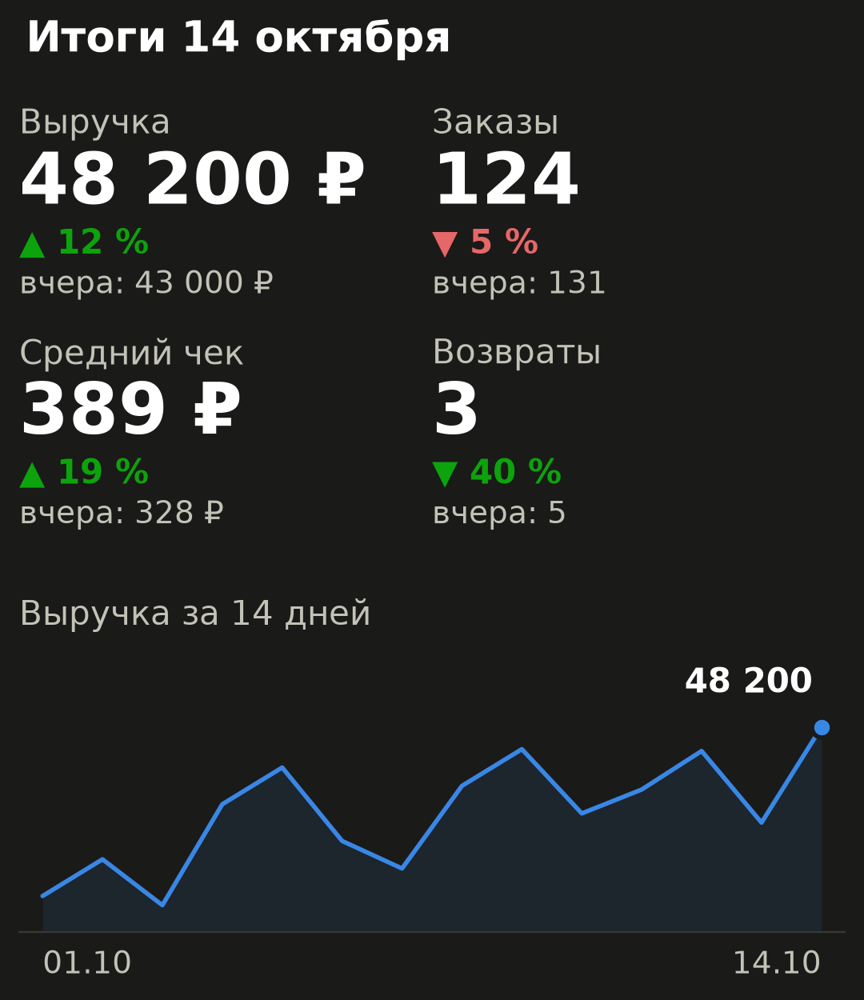

# БотГраф

Python-библиотека для чат-ботов: словарь с цифрами превращается в график, который читается
на экране телефона. Результат — PNG в памяти, готовый к отправке, или текст, если картинку
отправить нельзя.

| bar, светлая | line, тёмная | pie, светлая |
|---|---|---|
|  |  |  |

| сравнение с прошлым | две линии | календарь | карточка дня |
|---|---|---|---|
|  |  |  |  |

## Установка

```bash
pip install git+<ссылка-на-репозиторий>   # или из папки проекта: pip install .
pip install 'botgraph[aiogram]'            # + готовая отправка для aiogram 3
pip install 'botgraph[ptb]'                # + готовая отправка для python-telegram-bot 20+
```

Нужен Python 3.10+. Единственная обязательная зависимость — matplotlib 3.7+.

## Быстрый старт

```python
from botgraph import render_png, render_text, validate_payload, BotGraphValidationError

stats = {"title": "Найдено на фото за день", "labels": ["Кошки", "Собаки"], "values": [12, 8]}

png = render_png(stats, kind="bar", theme="dark")   # io.BytesIO, готов к отправке
text = render_text(stats, kind="bar")               # str, если фото отправить нельзя
payload = validate_payload(stats, kind="bar")       # только проверка: ChartPayload или ошибка
```

```
Найдено на фото за день
Кошки   ██████████  12
Собаки  ██████▋      8
```

Сразу в чат (aiogram или python-telegram-bot):

```python
from botgraph.integrations.aiogram import send_chart   # или botgraph.integrations.ptb

await send_chart(bot, chat_id, stats, kind="bar", caption="За сегодня")
```

Без кода, из терминала:

```bash
botgraph stats.json -k bar -o chart.png
```

## API

| Функция | Что возвращает |
|---|---|
| `render_png(data, kind="bar", theme="light")` | `io.BytesIO` с PNG шириной 1080 px, указатель в начале |
| `render_text(data, kind="bar")` | `str` для моноширинного шрифта |
| `validate_payload(data, kind="bar", theme="light")` | `ChartPayload` — проверенные и очищенные данные (для `card` — `CardPayload`) |
| `send_chart(bot, chat_id, data, kind="bar", theme="light", *, caption=None, as_text=False)` | отправленное сообщение; async, из `botgraph.integrations.aiogram` или `.ptb` |
| `BotGraphValidationError` | единственное исключение; наследник `ValueError`, поля `code`, `field`, `message` |

`kind`:

| kind | Что рисует | Формат данных |
|---|---|---|
| `"bar"` | горизонтальные столбики; с `previous` — метка прошлого значения и «▲ 20 %» | обычный |
| `"line"` | линия; с `previous` — вторая, приглушённая линия прошлого периода | обычный |
| `"pie"` | кольцевая диаграмма с суммой в центре | обычный |
| `"calendar"` | календарь-тепловая карта по дням, как вклады на GitHub | обычный, `labels` — даты |
| `"card"` | карточка дня: 1–4 крупных числа со сравнением и мини-график | свой, см. ниже |

`theme`: `"light"` или `"dark"`. Оформление (размеры, шрифты, цвета) задано пресетом и не настраивается.

### Обычный формат данных

Словарь или строка JSON:

```json
{"title": "Необязательный заголовок", "labels": ["Подпись 1", "Подпись 2"], "values": [12, 8.5]}
```

| Правило | Код ошибки |
|---|---|
| данные — словарь или корректная JSON-строка объекта | `INVALID_JSON` |
| есть `labels` и `values` | `MISSING_KEY` |
| списки не пустые | `EMPTY_DATA` |
| `labels` и `values` одинаковой длины | `LENGTH_MISMATCH` |
| bar: до 12 значений, line: до 31, pie: до 8 | `TOO_MANY_ITEMS` |
| `values` — конечные числа (не `bool`, не строка, не NaN/Inf) | `INVALID_VALUE_TYPE` |
| pie: от 2 значений, все ≥ 0, сумма > 0 | `INVALID_PIE_VALUES` |
| `kind` и `theme` из списков выше | `UNSUPPORTED_KIND`, `UNSUPPORTED_THEME` |
| подписи и заголовок — строки | `INVALID_TYPE` |
| других полей нет (защита от опечаток вроде `"value"`) | `UNKNOWN_FIELD` |
| символы есть в шрифте DejaVu Sans (кириллица и часть эмодзи — да, иероглифы — нет) | `UNSUPPORTED_GLYPH` (только `render_png`) |

Текст ошибки говорит, что исправить: `[LENGTH_MISMATCH] Поле 'values': Количество подписей (2) не совпадает
с количеством значений (1)`. Для программы — `e.code`, `e.field`, `e.message`.

Подписи очищаются: переносы строк и табуляция — в пробел, пробелы по краям убираются; пустая подпись
становится «#1», «#2»… Подпись длиннее 20 символов и заголовок длиннее 50 обрезаются с «…».

Большие числа сокращаются: `12 345`, `1,5 млн`, `2 млрд`.

### Сравнение с прошлым периодом (bar, line)

```json
{"labels": ["Telegram", "Сайт"], "values": [124, 86], "previous": [103, 92],
 "current_label": "эта неделя", "previous_label": "прошлая неделя"}
```

| Поле | По умолчанию | Смысл |
|---|---|---|
| `previous` | — | прошлые значения, столько же, сколько `values` |
| `current_label`, `previous_label` | «сейчас», «раньше» | подписи в легенде |
| `lower_is_better` | `false` | `true` для расходов, возвратов: рост — красный, падение — зелёный |

Изменение пишется со стрелкой — «▲ 20 %», «▼ 7 %», «= 0 %»; если прошлое значение 0, процент
не определён и показывается разница: «▲ +12». Цвет дублирует стрелку, а не заменяет её.

### Календарь (calendar)

```json
{"title": "Тренировки", "labels": ["2026-10-12", "2026-10-13", "2026-10-15"], "values": [1, 3, 2]}
```

Даты в формате ГГГГ-ММ-ДД, без повторов, в пределах 182 дней (26 недель), значения ≥ 0 (иначе `INVALID_DATE`, `NEGATIVE_VALUE`). Пропущенный день
считается нулём. Цвет — четверть от максимума; внизу «Отмечено N из M дн.» и серия дней подряд
до последней даты.

### Карточка дня (card)

```json
{"title": "Итоги 14 октября", "previous_label": "вчера",
 "metrics": [
   {"label": "Выручка", "value": 48200, "previous": 43000, "unit": "₽"},
   {"label": "Возвраты", "value": 3, "previous": 5, "lower_is_better": true}
 ],
 "trend": {"label": "Выручка за 3 дня", "labels": ["12.10", "13.10", "14.10"], "values": [41000, 43000, 48200]}}
```

| Поле | Обязательно | Правило |
|---|---|---|
| `metrics` | да | 1–4 метрики; у каждой `label` и `value`, по желанию `previous`, `unit` (до 6 символов), `lower_is_better` |
| `previous_label` | нет | с чем сравниваем, по умолчанию «вчера» |
| `trend` | нет | мини-график под числами: `labels` и `values` по правилам `line` (от 2 точек), `label` — подпись над ним |

## Отправка в чат

**Готовые адаптеры** рисуют в отдельном потоке (`asyncio.to_thread`) и отправляют фото.
С `as_text=True` отправляют текстовый вариант в `<pre>`. Ошибка в данных — `BotGraphValidationError` до отправки.

```python
from botgraph import BotGraphValidationError
from botgraph.integrations.aiogram import send_chart

try:
    await send_chart(bot, message.chat.id, stats, kind="card", theme="dark")
except BotGraphValidationError as e:
    await message.answer(f"Не получилось нарисовать: {e}")
```

**Вручную**, если нужен свой контроль:

```python
# aiogram 3
png = await asyncio.to_thread(render_png, stats, kind="bar")
await message.answer_photo(BufferedInputFile(png.getvalue(), filename="chart.png"))

# python-telegram-bot
await update.message.reply_photo(photo=await asyncio.to_thread(render_png, stats))

# текстом — моноширинно, колонки выровнены пробелами
await message.answer(f"<pre>{html.escape(render_text(stats))}</pre>", parse_mode="HTML")
```

**Без фреймворков** — [examples/telegram_send.py](examples/telegram_send.py), только стандартная библиотека.

Библиотека не трогает глобальные настройки matplotlib, параллельные вызовы из потоков безопасны.

## Командная строка

```bash
botgraph data.json -o chart.png                  # bar, светлая тема
botgraph data.json -k card -t dark -o card.png
botgraph data.json -k calendar --text            # текстовый вариант в терминал
cat data.json | botgraph - -k line -o - > chart.png
python3 -m botgraph data.json -o chart.png       # то же без установленного скрипта
```

Коды выхода: 0 — готово, 1 — не прочитать или не записать файл, 2 — ошибка в данных или аргументах
(текст ошибки — в stderr).

## Демо

Живое демо: https://botgraf.31-77-198-42.sslip.io — вставляете JSON, получаете картинку и текст.

```bash
python3 examples/web.py                                   # то же демо локально: http://127.0.0.1:8000
BOT_TOKEN=123:abc python3 examples/telegram_bot_demo.py   # демо-бот: примеры кнопками и график из своих данных
```

Демо-бот отправляет график фото, а если Telegram фото не принял — тем же графиком текстом.

HTTP API демо: `POST /api/png?kind=bar&theme=light` и `POST /api/text?kind=bar`, тело — JSON с данными;
ошибка в данных — 400 и текст ошибки. Боту данные отправляются сообщением: `card dark {"metrics": [...]}`.

Развёртывание (Docker, за реверс-прокси): `deploy/docker-compose.yml`, блок для Caddy — `deploy/Caddyfile.snippet`.

## Разработка

```bash
python3 -m venv .venv && .venv/bin/pip install -e '.[test,aiogram,ptb]'
.venv/bin/python -m pytest              # все предупреждения считаются ошибками
.venv/bin/python examples/demo.py out   # все графики в обеих темах — посмотреть глазами
```

## Чего нет (сознательно)

Интерактивных графиков, своих стилей, сложной статистики, хранения данных. Библиотека не
обращается к сети сама (отправляет только ваш `bot` в адаптерах) и ничего не пишет на диск,
кроме файла, явно указанного в командной строке.

## Развитие

1. Отчёты для бизнеса: Google Таблицы / 1С → карточка дня в Telegram каждое утро.
2. Адаптеры для VK и MAX.
